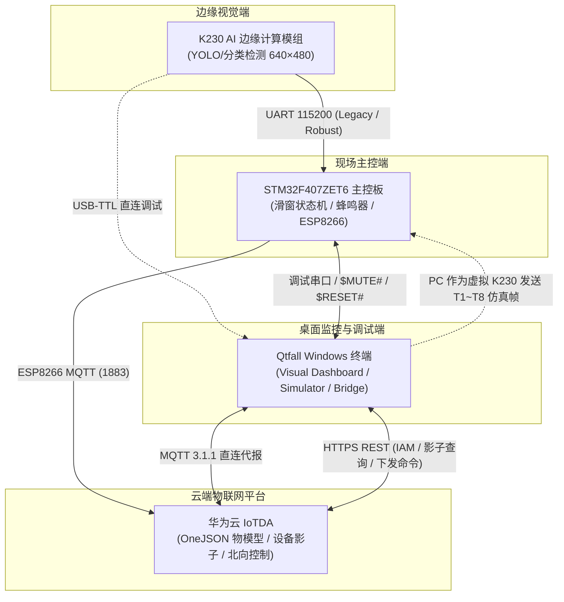

# Qtfall 老人跌倒检测 Windows 监控终端
## 使用操作说明与功能规格文档

---

### 文档信息
- **软件名称**：Qtfall (Elderly Fall Detection Monitoring & Debugging Terminal)
- **适配系统**：Windows 10 / Windows 11 (64-bit)
- **开发框架**：Qt 6.12.0 (MinGW 64-bit, C++17) + Qt Designer (.ui)
- **配套硬件**：K230 边缘 AI 视觉主板 + STM32F407ZET6 主控板
- **配套云端**：华为云 IoTDA 物联网平台 (MQTT 3.1.1 + HTTPS REST API)
- **构建工程**：`D:\13598\Desktop\falling\Qtfall\Qtfall.pro`

---

## 目录
1. [系统整体定位与协同架构](#1-系统整体定位与协同架构)
2. [主要功能特性全览](#2-主要功能特性全览)
3. [通信协议与数据格式说明](#3-通信协议与数据格式说明)
4. [界面布局与详细操作指南](#4-界面布局与详细操作指南)
   - [4.1 顶部全局控制区 (Header Bar)](#41-顶部全局控制区-header-bar)
   - [4.2 Tab 1：实时监控大屏 (Monitor)](#42-tab-1实时监控大屏-monitor)
   - [4.3 Tab 2：串口与云端连接 (Connection)](#43-tab-2串口与云端连接-connection)
   - [4.4 Tab 3：场景仿真与算法调优 (Simulator)](#44-tab-3场景仿真与算法调优-simulator)
   - [4.5 Tab 4：历史记录与系统日志 (History & Logs)](#45-tab-4历史记录与系统日志-history--logs)
5. [编译、构建与离线部署指南](#5-编译构建与离线部署指南)
6. [自动化单元测试与验证](#6-自动化单元测试与验证)
7. [常见问题排查 (FAQ)](#7-常见问题排查-faq)

---

## 1. 系统整体定位与协同架构

Qtfall 监控终端是专为**老年人跌倒检测预警系统**设计的桌面级集中监控、协议调试、仿真验证与云端联动中枢。它在整套端-边-云体系中扮演着承上启下的关键角色：



### 三种典型工作模式：
1. **独立上位机监控模式 (K230 直连)**：PC 串口直连 K230 模组，实时解析 AI 视觉坐标并在 PC 本地执行跌倒滑窗算法与告警。
2. **STM32 旁路监视与中控模式 (系统联调)**：PC 连接 STM32 调试串口，监听下位机运行日志与状态上报，下发 `$MUTE#`（消音）与 `$RESET#`（复位）控制下位机。
3. **云端数字孪生与北向联动模式**：无需硬件连线，通过华为云 IoTDA 设备影子实时同步老人状态，或通过 MQTT 模拟设备上报测试移动端/微信小程序联动。

---

## 2. 主要功能特性全览

| 模块类别 | 核心功能 | 功能描述 |
| :--- | :--- | :--- |
| **协议解析** | 双协议智能流式解析 | 同时自适应解析 K230 **Legacy** 文本帧 (`$x,y,w,h,State,score#`) 与 **Robust** 异或校验帧 (`$F,...*XOR\r\n`)，具备粘包/分片缓存与坏帧自动隔离机制。 |
| **下位机调试** | STM32 日志提取 | 自动捕获 `[FALL]`、`[ALARM]`、`[MQTT]`、`[MQTT-CMD]` 等下位机日志，一键提取命中数、置信度与状态。 |
| **实时可视化** | 目标框与轨迹映射 | 640×480 坐标空间映射，根据分类实时着色（红: Fall, 黄: Side-lying, 蓝: Sitting, 绿: Standing），支持历史质心运动轨迹追踪。 |
| **算法透视** | 滑动窗口与动态波形 | 10 格滑动窗口状态指示（绿色命中、灰色未中），置信度实时折线图绘制（带阈值辅助基准线）。 |
| **跌倒判决** | 算法状态机闭环 | 严格对齐 STM32 `app_fall.c` 核心判决逻辑（10 帧滑窗、6 帧门限、`w > h` 几何过滤、`SideLying` 可选跌倒、30s 报警保持、10s 冷却抑制、5s 离线超时）。 |
| **声光警报** | 本地多媒体告警 | 采用 Windows 原生 WinMM API 异步循环播放告警音，支持单键消音 (MUTE)、系统复位 (RESET) 及声效试听。 |
| **通信接入** | Win32 原生串口引擎 | 采用 Windows SetupAPI / Win32 原生调用，彻底摆脱对 `QtSerialPort` 模块的依赖，支持热插拔刷新与 HEX/文本混合监视。 |
| **华为云 IoTDA** | MQTT 3.1.1 协议编解码 | 内置纯 Qt 实现的 MQTT 客户端，支持华为云 OneJSON 属性上报 (`FallDetect`) 与平台命令接收响应。 |
| **华为云北向** | HTTPS IAM 与设备影子 | 支持获取 IAM Token、主动查询 Device Shadow、北向应用命令下发（彻底避免因多客户端使用同一 DeviceId 导致 MQTT 互踢）。 |
| **测试仿真** | T1~T8 标准场景回放 | 内置开发文档 §9 规定的标准场景（T1 正常行走、T2 蹲下防抖、T3 快速跌倒、T4 跌倒后起身、T8 离线断连），支持虚拟 K230 串口外发与单帧注入。 |
| **数据追溯** | 历史持久化与 CSV 导出 | 自动落盘 `alarm_history.json`，多条件检索过滤，一键导出带 UTF-8 BOM 的 Excel 兼容 CSV 报表。 |

---

## 3. 通信协议与数据格式说明

### 3.1 K230 视觉通信协议

#### (1) Legacy 协议（文本帧）
- **格式**：`$x,y,w,h,State,score#`
- **示例**：`$200,305,245,115,Fall,0.88#`
- **字段定义**：
  - `x, y`：包围框左上角像素坐标（基准分辨率 640×480）。
  - `w, h`：包围框宽度与高度（像素）。
  - `State`：姿态字符串，取值为 `Fall` 或 `NoFall`。
  - `score`：识别置信度，取值范围 `0.00 ~ 1.00`。

#### (2) Robust 协议（带校验帧）
- **格式**：`$F,<evt>,<state>,<cls>,<score_x100>,<cx>,<cy>,<seq>*<XOR>\r\n`
- **示例**：`$F,1,1,0,87,52,61,0*65\r\n`
- **字段定义**：
  - `evt`：事件标记（0: 无事件, 1: 触发跌倒瞬态）。
  - `state`：状态机标志（0: 未跌倒, 1: 跌倒）。
  - `cls`：AI 模型分类编号（0: `fall`, 1: `side-lying`, 2: `sitting`, 3: `standing`）。
  - `score_x100`：置信度百分比（如 87 代表 0.87）。
  - `cx, cy`：归一化质心坐标（`0 ~ 100`，映射到 640×480 分辨率）。
  - `seq`：帧序号（`0 ~ 255` 循环累加）。
  - `*XOR`：`$` 与 `*` 之间所有字符的异或校验和（2 位十六进制大写）。

### 3.2 串口双向控制命令
| 命令字 | 传输方向 | 作用说明 |
| :--- | :--- | :--- |
| `$MUTE#` | PC / 云端 -> STM32 / PC | 静音当前正在鸣响的蜂鸣器，但系统仍保持报警状态与界面告警。 |
| `$RESET#` | PC / 云端 -> STM32 / PC | 强制退出报警/冷却状态，清空滑窗历史，将系统重置为 IDLE 闲置态。 |

### 3.3 华为云 IoTDA 数据格式 (OneJSON)
- **MQTT 属性上报 Topic**：
  `$oc/devices/{deviceId}/sys/properties/report`
- **Payload 格式**：
```json
{
  "services": [
    {
      "service_id": "FallDetect",
      "properties": {
        "fall_state": 1,
        "confidence": 0.88,
        "x": 200,
        "y": 305,
        "w": 245,
        "h": 115,
        "beep_on": 1,
        "vision_offline": 0
      }
    }
  ]
}
```

---

## 4. 界面布局与详细操作指南

软件采用 **Dark Slate (深色现代工业风)** 主题，界面完全在 [falling.ui](file:///D:/13598/Desktop/falling/Qtfall/falling.ui) 中布局设计，支持窗口自由缩放与分栏拖动。

### 4.1 顶部全局控制区 (Header Bar)
顶部区域在所有标签页常驻显示，用于掌握系统全局态势并进行应急控制：

```
[ ● 正常监视 (IDLE) ]  [ 串口: COM3 (115200) ]  [ K230 视觉: 在线 (10.0 fps) ]  [ 华为云 MQTT: 已连接 ]  [ 蜂鸣器: 静音 ]  [☑ 声音告警]  [ 🔕 消音 (MUTE) ]  [ 🔄 复位 (RESET) ]
```

1. **系统状态大徽章 (`lblSysBadge`)**：
   - `● 正常监视 (IDLE)`（深绿背景）：系统处于正常检测待机状态。
   - `● 跌倒报警 (ALARM)`（深红背景 + 粗体）：检测到跌倒且滑窗达到门限，警报触发中。
   - `● 冷却抑制 (COOLDOWN)`（橙黄背景）：报警解除后的防重触发保护期。
2. **状态胶囊群**：
   - **串口胶囊**：显示已打开串口名与波特率，未连接时为灰底。
   - **K230 视觉胶囊**：实时显示当前帧率（如 `在线 (10.2 fps)`）；若超过设定超时未收到有效帧，自动切为红底 `超时掉线`。
   - **华为云 MQTT 胶囊**：显示 MQTT 连接状态（绿底 `已连接` / 灰底 `未连接`）。
   - **蜂鸣器胶囊**：红底 `报警鸣响` / 灰底 `静音`。
3. **快捷控制按键**：
   - `☑ 声音告警`：勾选后在触发报警时发出 PC 本地急促提示音；取消勾选则保持系统静音。
   - `🔕 消音 (MUTE)`：单击后对正在报警的系统执行消音，向串口同步发送 `$MUTE#` 并记录日志。
   - `🔄 复位 (RESET)`：单击后强制重置判决状态机，恢复 IDLE，向串口同步发送 `$RESET#`。

---

### 4.2 Tab 1：实时监控大屏 (Monitor)

大屏划分为左右两大区域（可通过中间分割条自由拖动比例）：

#### 左侧：视觉空间与目标追踪
- **视觉画布 (`canvasVision`)**：
  - 黑色背景映射 K230 640×480 成像视野，带有低对比度网格线与中心十字准星。
  - **动态包围框**：根据目标位置绘制矩形框，带有发光边角与半透明填充；顶部附带姿态名称与置信度标签。
    - 🔴 **红色**：Fall（跌倒）
    - 🟡 **黄色**：Side-lying（侧卧）
    - 🔵 **蓝色**：Sitting（坐姿）
    - 🟢 **绿色**：Standing / NoFall（站立/正常）
  - **质心轨迹**：平滑记录最近 20 帧目标的中心移动路径，快速捕捉人体跌落瞬间的速度与方向偏移。
  - **离线提示**：当视觉掉线时，画布正中浮现半透明警告提示框。
- **状态副信息**：实时展示目标框矩形数据 `(x, y, w×h)`、当前匹配协议版本 (`Legacy` / `Robust`)、有效帧累计与坏帧丢弃计数。

#### 右侧：指标卡、算法透视与快览
- **核心指标卡群**：
  - **当前姿态**：展示中文识别分类（跌倒 / 侧卧 / 坐姿 / 站立）。
  - **置信度指示器**：百分比进度条实时变色展示（>80% 绿、50~80% 蓝、<50% 灰）。
  - **累计报警次数**：统计自终端启动以来的总报警次数。
  - **保持剩余时间**：显示处于 `ALARM` 或 `COOLDOWN` 阶段的倒计时秒数。
- **滑动窗口槽位指示 (`widgetWindowSlots`)**：
  - 直观排布 10 个方块槽位，从左至右代表最旧到最新帧。
  - 亮绿色表示该帧满足跌倒且通过几何过滤，灰色表示未命中；底端清晰标出 `当前命中: X / 门限: Y`。
- **动态置信度曲线 (`chartConfidence`)**：
  - 绘制最近 60 帧的置信度折线走势图。
  - 橘黄色虚线标出当前设定的判断阈值线（默认 0.50）；发生跌倒判决命中的采样点以高亮圆点标注。
- **最近事件快览表 (`tableRecentEvents`)**：倒序滚动显示最新的 25 条关键事件（时间、触发源、事件类型、置信度、说明），跌倒事件行以醒目粉红高亮提示。

---

### 4.3 Tab 2：串口与云端连接 (Connection)

本页面分为“硬件串口管理”与“华为云 IoTDA 双通道联调”两大板块：

#### 1. 硬件串口管理 (Win32 原生)
- **串口选择与连接**：
  - 点击 `刷新列表`：自动检索系统中当前可用的物理串口与 USB-TTL 虚拟串口（显示厂商与设备说明，如 `COM3 (CH340)`）。
  - 选择波特率（默认 `115200`，支持 9600~921600）。
  - **工作角色选择**：
    - `自动适应 (Auto)`：同时监听数据并运行 PC 算法。
    - `K230 视觉直连 (PC执行判决)`：直连 K230，PC 本地接管滑窗与跌倒报警。
    - `STM32 调试终端 (仅监视与控制)`：仅监听板端日志并在界面画框，避免本地算法干扰板端判决。
  - 勾选 `收到有效帧后自动代报至华为云`：可在 PC 端作为软网关，把 K230 数据透明转发到华为云。
- **串口监视器**：
  - 文本区实时打印接收与发送数据（带有彩色 `RX` / `TX` 标识）。
  - 具备 `暂停滚动`、`HEX 十六进制显示`、`清空监视` 功能。
  - 下方快捷发送栏支持回车发送，并附带 `$MUTE#` 与 `$RESET#` 专属按键。

#### 2. 华为云 IoTDA 联动 (MQTT + 北向 HTTPS)
支持双通道操作，既能像下位机一样以设备身份通信，也能像业务 App 一样北向纳管：

- **子标签 A：MQTT 设备代报通道 (Device MQTT)**：
  - 参数包含：Broker 域名/IP（默认 `iot-mqtts.cn-north-4.myhuaweicloud.com`）、端口（1883）、Device ID、Service ID (`FallDetect`)、Client ID、用户名与密码。
  - **快捷导入**：单击 `从 app_mqtt.h 一键导入`，系统自动检索本地工程并导入 `#define MQTT_BROKER_HOST`、`HUAWEI_DEVICE_ID`、`MQTT_CLIENT_ID` 等参数，免去繁琐的手工填写。
  - 单击 `连接 MQTT`：建立长连接，支持自动 Keepalive 与订阅命令 Topic。
  - 单击 `立即上报当前状态`：把当前的跌倒状态与坐标以 OneJSON 封装发往云端。
- **子标签 B：北向应用与影子 (Northbound REST & Shadow)**：
  - 用于以管理员/云端应用身份访问华为云，**彻底解决与 STM32 抢占同一 MQTT ClientId 导致互踢**的问题。
  - 单击 `获取 IAM Token`：向华为云 IAM 服务发起鉴权换取临时 Token。
  - 单击 `查询设备影子`：获取板端在云端登记的最新状态。
  - 勾选 `启用影子自动轮询 (每 5 秒)`：启动后台静默定时查询，实现数字孪生监视。
  - 单击 `北向发送 MUTE / RESET`：通过 HTTPS API 向设备下发命令。

---

### 4.4 Tab 3：场景仿真与算法调优 (Simulator)

本页面为系统测试与算法研究的核心工具库：

#### 1. 开发文档 §9 标准场景一键回放
针对工程规范中定义的标准用例，提供真实数据流仿真回放：
- **`▶ T1 正常行走 (NoFall)`**：连续发送站立人形移动帧，置信度高，验证系统平稳保持 IDLE。
- **`▶ T2 缓慢蹲下 (防抖过滤)`**：模拟系鞋带等下蹲姿态，在第 4、5 帧注入窄框或低置信度瞬态干扰，验证滑窗防抖与几何过滤能有效压制误报。
- **`▶ T3 快速跌倒 (触发报警)`**：前 3 帧站立，第 4 帧起突变为扁平横框 (`w > h`)，连续多帧跌倒，验证滑窗在达到第 6 帧时果断切入 ALARM 状态，鸣响蜂鸣器并记录事件。
- **`▶ T4 跌倒后起身 (保持与冷却)`**：经历跌倒报警后起身站立，验证 30 秒报警锁存（NoFall 无法提前解除）及随后的 10 秒冷却抑制期（期间即使再跌倒也不重复惊扰）。
- **`▶ T8 离线断连 (心跳超时)`**：正常发帧后突然掐断帧流，验证系统在达到 5 秒门限后触发 `visionOfflineChanged`，将大屏标为掉线。
- **仿真控制**：可自由切换 `Legacy` 或 `Robust` 编码，调节输出速率（1~30 FPS），勾选 `同时将仿真帧从已打开串口发出` 可将本终端化身为**硬件仿真测试工装**，通过真实串口线缆给 STM32 硬件板卡喂数据！

#### 2. 单帧参数手工注入 (Manual Frame Injector)
支持自定义目标坐标 `(X, Y, W, H)`、姿态类别（Fall / NoFall / SideLying / Sitting / Standing）以及置信度，单击 `单帧注入` 可观察滑窗内部每一格的瞬时响应。

#### 3. 判决策略参数在线调优
参数修改后单击 `应用并生效` 立即刷新，亦可随时 `恢复出厂默认值`：
- **置信度门限**（默认 `0.50`）：低于该门限的帧直接算作未命中。
- **滑窗长度与命中门限**（默认 `10 帧 / 6 帧命中`）：调整抗抖动的灵敏度。
- **报警保持时间**（默认 `30 秒`）：人体跌倒可能失去意识，锁存状态确保云端与监护人收到报警。
- **冷却防抖时间**（默认 `10 秒`）：报警退出后的防抖缓冲。
- **视觉掉线超时**（默认 `5 秒`）：超出该时间未收到帧即告警。
- **启用几何形态过滤 (w > h)**（默认 `开启`）：只把宽度大于高度的横卧姿态算作跌倒，排除站立垂直框。
- **将侧卧 (Side-Lying) 视作跌倒**（默认 `关闭`）：可根据特定照料场景灵活勾选。

---

### 4.5 Tab 4：历史记录与系统日志 (History & Logs)

#### 1. 报警与控制历史列表
- **复合过滤引擎**：
  - 搜索框：支持对事件源、类型、说明信息进行任意模糊字词搜索。
  - 分类下拉框：支持按 `全部事件`、`仅跌倒报警`、`仅消音与复位控制`、`仅视觉掉线与恢复` 分流查看。
- **历史数据呈现**：展示记录 ID、详细时间戳、触发源（本地仿真 / 串口 / 华为云影子）、事件类型、置信度、包围框参数 `[x,y,w,h]` 与备注信息。
- **数据持久化与导出**：
  - `导出 CSV 报表`：生成带有标准 UTF-8 BOM 签名的 `.csv` 文件，使用 Microsoft Excel、WPS 或 Python Pandas 打开均不乱码。
  - `保存 JSON 文件`：完整导出原始结构化数据。
  - `清空全部历史`：重置历史记录并更新持久化缓存文件。

#### 2. 系统运行日志监控
右侧文本区记录底层关键动作（串口开启/关闭、MQTT 重连、北向 API 返回、坏帧过滤日志等），具备 1000 行自动滚动截断能力，便于定位疑难问题。

---

## 5. 编译、构建与离线部署指南

### 5.1 开发环境依赖
- **操作系统**：Windows 10 / Windows 11 (64 位)
- **编译工具链**：Qt 6.12.0 MinGW 64-bit (GCC 13.1.0 或兼容版本)
- **Qt 核心组件**：`QtCore`, `QtGui`, `QtWidgets`, `QtNetwork`
- **系统链接库**：`-lwinmm -ladvapi32 -lsetupapi`（已配置在 `Qtfall.pro` 中，无需手动添加）

### 5.2 在 Qt Creator 中打开与构建（推荐）
1. 打开 Qt Creator，选择 `文件` -> `打开文件或项目...`。
2. 选取 `D:\13598\Desktop\falling\Qtfall\Qtfall.pro`。
3. 构建套件（Kit）选择 `Desktop Qt 6.12.0 MinGW 64-bit`。
4. 点击左下角 **运行 (Ctrl+R)** 或 **构建 (Ctrl+B)** 即可一键编译并启动。

### 5.3 命令行编译步骤
若使用 PowerShell 进行静默编译，执行以下命令：
```powershell
# 1. 设置环境变量（临时加入 Qt 与 MinGW 工具链路径）
$env:PATH = "D:\Qt\6.12.0\mingw_64\bin;D:\Qt\Tools\mingw1310_64\bin;" + $env:PATH

# 2. 进入工程目录并创建构建文件夹
cd D:\13598\Desktop\falling\Qtfall
mkdir build\release_build -Force
cd build\release_build

# 3. 执行 qmake 生成 Makefile
qmake ..\..\Qtfall.pro -spec win32-g++ "CONFIG+=release"

# 4. 调用 mingw32-make 进行多核并行编译
mingw32-make -f Makefile.Release -j4
```
编译成功后，将在 `build\release_build\release\` 目录下生成 `Qtfall.exe`。

### 5.4 独立电脑离线运行与依赖打包 (windeployqt)
如果需要将编译好的 `Qtfall.exe` 复制到没有安装 Qt SDK 的全新电脑上运行，请在包含生成好的 `.exe` 目录执行部署工具：
```powershell
$env:PATH = "D:\Qt\6.12.0\mingw_64\bin;D:\Qt\Tools\mingw1310_64\bin;" + $env:PATH
cd D:\13598\Desktop\falling\Qtfall\build\release_build\release
windeployqt.exe Qtfall.exe --no-translations --compiler-runtime
```
该命令会自动将所需的 Qt 核心动态链接库（`Qt6Core.dll`、`Qt6Gui.dll`、`Qt6Widgets.dll`、`Qt6Network.dll`）、MinGW 运行时库（`libgcc_s_seh-1.dll`、`libstdc++-6.dll`、`libwinpthread-1.dll`）以及 `platforms/qwindows.dll` 自动复制到同级目录，形成开箱即用的绿色软件包。

---

## 6. 自动化单元测试与验证

本项目遵循严格的代码质量保证规范，配备两套独立的自动化测试工程：

### 6.1 核心协议与算法单元测试 (`tests/tst_qtfall.pro`)
- **测试源码**：[tst_qtfall.cpp](file:///D:/13598/Desktop/falling/Qtfall/tests/tst_qtfall.cpp)
- **覆盖用例（共 25 项全通）**：
  1. `testLegacyFrameValidAndRoundtrip`：Legacy 文本协议正常编解码互转
  2. `testLegacyFrameRejectsInvalid`：异常坐标、超限置信度、乱码帧拦截
  3. `testRobustFrameValidAndChecksum`：Robust 协议异或校验和精确计算
  4. `testRobustFrameRejectsBadXor`：单字节比特翻转与校验和篡改拦截
  5. `testStreamingMixedChunksAndOverflow`：环形缓冲区半包、粘包与连续分片重组
  6. `testStm32DebugLogsParsing`：下位机 4 类关键调试日志字段提取
  7. `testJudgeWindowTriggersOnSixHitsWithGeometry`：10 帧滑窗达 6 帧命中触发报警
  8. `testJudgeGeometryFilterRejectsTallBox`：`w <= h`（站立细高框）强制压制拦截
  9. `testJudgeHoldAndCooldownLifecycle`：30s 锁存与 10s 冷却状态机生命周期流转
  10. `testJudgeMuteAndReset`：消音与强制复位控制响应
  11. `testJudgeSideLyingToggleAndOfflineTimeout`：侧卧跌倒策略切换与 5s 掉线检测
  12. `testMqttRemainingLengthVarint`：MQTT 变长报头编码与解码
  13. `testMqttConnectAndConnAckRoundtrip`：MQTT 3.1.1 CONNECT 报文打包与 CONNACK 解析
  14. `testMqttPublishQos1AndSubscribeRoundtrip`：QoS 1 发布、PUBACK 确认与订阅报文
  15. `testMqttPartialBufferDecode`：TCP 流式分包粘包重组
  16. `testIotdaOneJsonReportFormat`：华为云 OneJSON 属性上报报文校验
  17. `testIotdaCommandParseAndResponse`：MUTE/RESET 平台命令解析与响应封装
  18. `testIotdaShadowParse`：设备影子 JSON 报文提取
  19. `testIotdaParseAppMqttHeader`：STM32 `app_mqtt.h` 头文件参数自动提取
  20. `testEventLoggerCsvAndJsonRoundtrip`：CSV 报告格式与 JSON 持久化往返无损
  21. `testSimulatorT3TriggersJudgeEngine`：仿真引擎与判决引擎全链路集成
  22. `testSoundAlertSynthesizeWavHeader`：内存 PCM WAV 音频头合成
  23. `testWinSerialPortEnumSmoke`：Win32 原生串口枚举冒烟
- **运行方式**：
  ```powershell
  cd D:\13598\Desktop\falling\Qtfall\build\tests
  .\release\tst_qtfall.exe
  ```
  **实测输出**：`Totals: 25 passed, 0 failed, 0 skipped, 0 blacklisted, 13ms`。

### 6.2 UI 界面集成与冒烟测试 (`tests/tst_ui.pro`)
- **测试源码**：[tst_ui.cpp](file:///D:/13598/Desktop/falling/Qtfall/tests/tst_ui.cpp)
- **覆盖用例（共 5 项全通）**：
  1. `testUiStructureTabSwitchAndCustomPaint`：验证 `.ui` 控件树完整加载、4 大 Tab 切换流畅度，以及三大自定义控件（画布、槽位、波形图）执行 `grab()` 渲染无空指针与除零崩溃。
  2. `testSimulationAlarmMuteResetAndHistory`：模拟用户点击 T3 仿真启动，界面自动联动报警 -> 徽章变红 -> 计数器加 1 -> 点击 Mute 静音 -> 点击 Reset 复位 -> 自动写入历史记录全链路。
  3. `testSideLyingStrategyAndManualInjection`：侧卧模式动态开启，单帧参数手工注入连发触发报警。
- **运行方式**：
  ```powershell
  cd D:\13598\Desktop\falling\Qtfall\build\tests_ui
  .\release\tst_ui.exe -platform offscreen
  ```
  **实测输出**：`Totals: 5 passed, 0 failed, 0 skipped, 0 blacklisted, 745ms`。

---

## 7. 常见问题排查 (FAQ)

### Q1：为什么我的电脑打开软件后，“串口下拉框”为空？
- **解答**：
  1. 请检查 USB-TTL 转换模块（如 CH340、CP2102、FT232）是否已稳固插入电脑，并在 Windows 设备管理器中确认驱动是否正常工作（无黄色感叹号）。
  2. 插好后，在软件的 `串口与云端连接` 页面点击 `刷新列表` 即可重新扫描识别。

### Q2：终端连接华为云 MQTT 时，为什么频繁提示断开或连接失败？
- **解答**：
  1. **ClientId 唯一性冲突（最常见原因）**：MQTT 协议规定同一个 ClientId 在同一时刻只允许一个客户端在线。如果您的 STM32 板卡或微信小程序正在使用完全相同的 ClientId 连接华为云，两者会发生“互相踢下线”现象。
  2. **解决方案**：在 PC 终端中，推荐在 `MQTT Client ID` 后面追加后缀（例如 `_pc_monitor`），或直接使用本软件的 **“北向应用与影子 (Northbound REST)”** 页面通过 HTTPS Token 进行安全监视与控制。

### Q3：画面上有目标框在移动，为什么滑窗指示器一直是灰色、没有触发报警？
- **解答**：
  1. **检查置信度**：默认阈值为 `0.50`。如果视觉端发送的 score 低于 0.50，该帧会被判定为低置信度噪点而丢弃。
  2. **检查几何比例校验 (w > h)**：站立姿态通常人体是垂直细长的（`w < h`），此时即使模型偶发误报为 Fall，算法中的几何过滤器也会拦截它；只有当人体真正摔倒或横躺在地呈水平分布（`w > h`）时才会计入有效命中。可在 `场景仿真与算法调优` 页面临时取消勾选 `启用几何形态过滤` 进行对比验证。
  3. **检查滑窗门限**：默认需要 10 帧内累计达到 6 帧命中，单帧干扰不会引起误报。

### Q4：在没有物理开发板的情况下，如何验证整套软件的功能？
- **解答**：
  切换至 `场景仿真与算法调优` 标签页，点击 `▶ T3 快速跌倒 (触发报警)`，然后立刻切回 `实时监控大屏`，即可全方位查看目标框横卧摔倒、运动轨迹下拉、槽位依次点亮、触发红色 ALARM 警报、波形跃升以及历史事件自动记录的完整动态响应。

---

*文档编写完成于 2026-11-13 | 对应工程源码：`D:\13598\Desktop\falling\Qtfall`*
