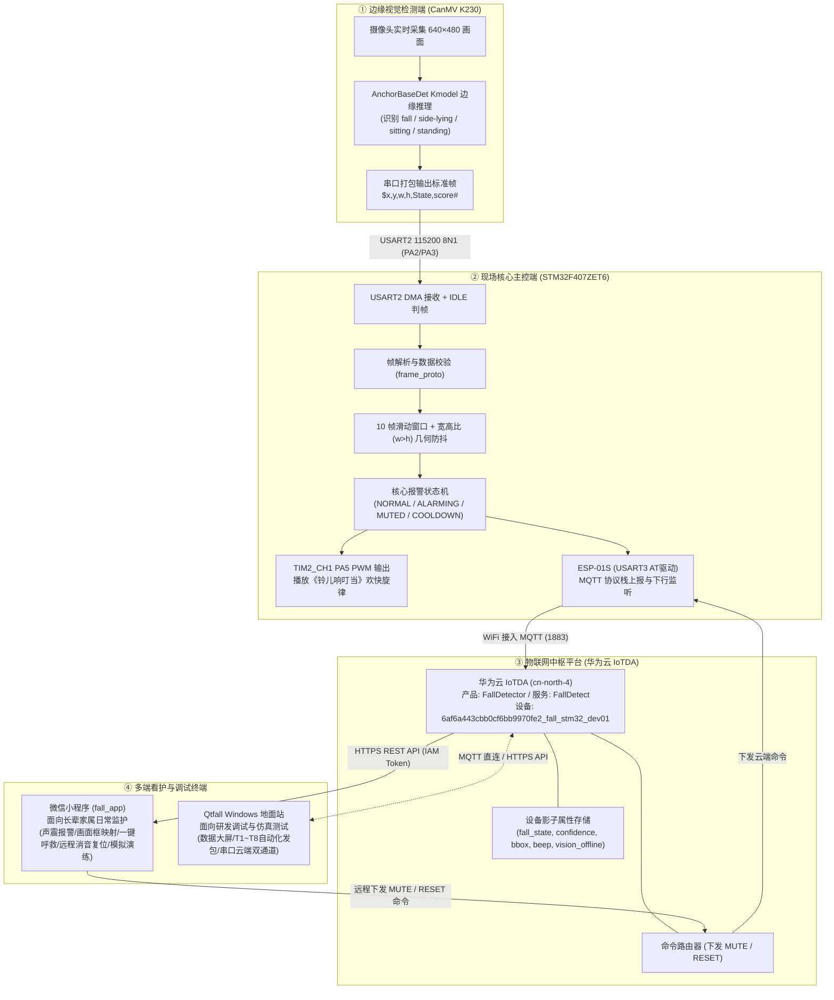
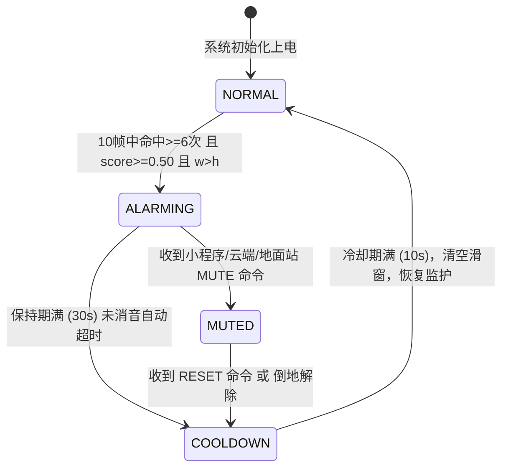

# 居家老人防跌倒监测与报警系统
## 功能规格与使用操作说明书

---

### 文档信息
- **系统名称**：基于 K230 边缘视觉与 STM32 架构的居家老人防跌倒监护系统
- **文档版本**：v1.0 (正式发布版)
- **更新日期**：2026-11-13
- **适用硬件**：
  - 边缘视觉：嘉楠/亚博智能 CanMV K230 豪华版模组（自带双核 RISC-V 1.6GHz + 0.8TOPS NPU）
  - 现场主控：STM32F407ZET6 M4 核心板 v1.2（168MHz Cortex-M4 + FreeRTOS）
  - 物联网通信：ESP-01S / ESP8266 WiFi 模组（标准 AT 固件 + MQTT 3.1.1 客户端）
  - 本地声光：板载三极管驱动蜂鸣器（PA5 / TIM2_CH1 PWM 音乐发生器）
- **适用软件**：
  - 家人端小程序：`fall_app` 微信小程序（TypeScript + LESS + 3-Tab 架构）
  - 调试地面站：`Qtfall` Windows 桌面监控终端（Qt 6.12.0 + C++17）
  - 云端接入：华为云 IoTDA 物联网平台（华北-北京四 `cn-north-4`）
- **工程根路径**：[falling](file:///d:/13598/Desktop/falling)

---

## 目录
1. [系统整体架构与协同机制](#1-系统整体架构与协同机制)
2. [硬件组成与物理接线指南](#2-硬件组成与物理接线指南)
3. [K230 边缘端 AI 跌倒检测部署与运行](#3-k230-边缘端-ai-跌倒检测部署与运行)
4. [STM32F407 主控固件与判决算法](#4-stm32f407-主控固件与判决算法)
5. [华为云 IoTDA 平台与物模型配置](#5-华为云-iotda-平台与物模型配置)
6. [微信小程序 (fall_app) 功能与操作指南](#6-微信小程序-fall_app-功能与操作指南)
7. [Qtfall 桌面地面站联动调试 (可选)](#7-qtfall-桌面地面站联动调试-可选)
8. [系统标准操作流程 (SOP)](#8-系统标准操作流程-sop)
9. [常见故障排查手册 (FAQ)](#9-常见故障排查手册-faq)

---

## 1. 系统整体架构与协同机制

### 1.1 系统设计定位
针对独居或居家养老长辈，本系统构建了**“边缘端视觉毫秒级初筛 + 主控板滑动窗口几何防抖 + 本地欢快旋律声光告警 + 华为云 IoTDA 影子同步 + 微信小程序家人一键呼叫与远程处置”**的五位一体闭环监护体系。



### 1.2 核心技术指标
- **视觉推理分辨率**：`640 × 480`（兼顾广角监护视野与边缘 NPU 推理帧率）。
- **帧率与通信周期**：K230 边缘推理约 15~25 FPS；串口连续上报周期约 50~100ms。
- **抗误报多级防抖判决**：
  - 10 帧滑动窗口：要求在最近 10 帧中，跌倒特征命中次数 $\ge 6$ 次。
  - 置信度门限：单帧模型评分 $\ge 0.50$（典型跌倒置信度在 $0.60 \sim 0.90$）。
  - 几何姿态约束：目标框宽高比 $w > h$（平躺横向分布，滤除正常站立或弯腰动作）。
- **报警响应时延**：从老人倒地到本地蜂鸣器奏响 $\le 0.8$ 秒；上报华为云并触发手机小程序告警 $\le 1.8$ 秒。
- **告警音乐特性**：PA5 引脚配置为 TIM2_CH1 PWM 方波输出，动态合成 C 大调标准音阶，以 187 BPM 节拍循环播放《铃儿响叮当》(Jingle Bells) 欢快副歌，既有极强警示性又避免传统尖锐蜂鸣音引起长辈心悸惊慌。

---

## 2. 硬件组成与物理接线指南

### 2.1 核心硬件清单
| # | 组件名称 | 型号/规格 | 在系统中的作用与职责 |
|---|---|---|---|
| 1 | 边缘视觉主板 | 亚博智能 CanMV K230 豪华版 | 运行 MicroPython 与 Kmodel 深度学习模型，负责图像采集与边缘跌倒识别 |
| 2 | 主控单片机 | XDEDU STM32F407ZET6 M4 核心板 v1.2 | 运行 FreeRTOS 多任务，负责协议解析、滑动窗口滤波、蜂鸣器音乐播放与通信调度 |
| 3 | WiFi 联网模块 | ESP-01S (ESP8266 芯片，烧录标准 AT 固件) | 直插主控板 P9 专用插槽，通过 AT 指令接入无线路由器并维护华为云 MQTT 长连接 |
| 4 | 声光提示器 | 板载蜂鸣器驱动电路 (Q1 三极管 + PA5 控制) | TIM2_CH1 硬件 PWM 驱动，跌倒时播放《铃儿响叮当》旋律；支持远程软件消音 |
| 5 | 供电与配件 | 5V/2A 独立电源适配器、杜邦线 4 根、Type-C 数据线 | 提供充足电源功率储备，严防 ESP8266 射频突发大电流引发系统复位 |

### 2.2 详细接线对照表（STM32 与 K230）

> [!IMPORTANT]
> 必须保证 K230 与 STM32F407 主板的 **GND 严格共地**。若地线未接或接触不良，串口信号将产生电平漂移，导致帧头乱码或超时无法识别。

K230 豪华版正面 Type-C 接口旁的 **EXPORT 4Pin 扩展通信接口**（白色防反插座），与 STM32F407 核心板的接线定义如下：

| K230 EXPORT 接口引脚 | 信号定义 | 方向 | STM32F407ZET6 核心板引脚 | 说明 |
|---|---|---|---|---|
| **Pin 1 (5V)** | 电源输入/输出 | $\leftrightarrow$ | **5V 排针** (或外部 5V 稳压源) | 保证供电充沛（建议使用标配双口供电） |
| **Pin 2 (GND)** | 信号与电源地 | --- | **GND 排针** | **硬性要求：必须与 STM32 共地** |
| **Pin 3 (IO9)** | K230 UART1_TXD | $\rightarrow$ | **PA3 (USART2_RX)** | K230 识别结果上报至 STM32 |
| **Pin 4 (IO10)**| K230 UART1_RXD | $\leftarrow$ | **PA2 (USART2_TX)** | STM32 向 K230 回传消音/复位确认（可选） |

```
   K230 豪华版 EXPORT 接口                      STM32F407ZET6 M4 核心板
   ┌──────────────────────┐                    ┌──────────────────────────┐
   │ [1] 5V  ────────────┼────────────────────┼── 5V                     │
   │ [2] GND ────────────┼────────────────────┼── GND (必须共地)          │
   │ [3] IO9 (TXD) ──────┼───────────────────▶│── PA3 (USART2_RX)        │
   │ [4] IO10(RXD) ◀─────┼────────────────────┼── PA2 (USART2_TX)        │
   └──────────────────────┘                    │                          │
                                               │ P9 8266 插槽 (直插板载)   │
                                               │   ├── PB10 (USART3_TX)   │
                                               │   └── PB11 (USART3_RX)   │
                                               │                          │
                                               │ PA5 (TIM2_CH1 PWM 蜂鸣器)│
                                               │ PA9/PA10 (USART1 调试口) │
                                               └──────────────────────────┘
```

### 2.3 核心板板载模组插接与调试串口
- **ESP-01S 模块**：直接插入核心板右上角的 **P9 (8266) 专用模块座**（板载独立的 3.3V 低压差 LDO 电源芯片 U29 供电，直连 PB10/PB11 串口 3）。无需额外杜邦线接线。
- **USART1 调试串口**：核心板排针 **PA9 (TX) / PA10 (RX)** 已引出。可通过 USB-TTL 串口小板连接 PC，使用串口调试助手或 Qtfall 地面站查看主控实时运行日志（波特率 `115200`，数据位 `8`，停止位 `1`，无校验 `None`）。

---

## 3. K230 边缘端 AI 跌倒检测部署与运行

### 3.1 算法模型与部署文件
K230 模组上运行基于嘉楠在线训练平台量化的 AnchorBase 目标检测模型，模型及推理代码均存放在 MicroSD 卡中：
- 模型路径：`/sdcard/mp_deployment_source/best_AnchorBaseDet_can2_5_s_20261113094208.kmodel`
- 配置文件：`/sdcard/mp_deployment_source/deploy_config.json`
- Python 推理脚本：`fall_detect_uart.py`（存放在 [k230_fall_detect](file:///d:/13598/Desktop/falling/k230_fall_detect) 目录）

该模型具备 4 类人体姿态细分能力：
1. `fall`：跌倒状态（躯干贴地、水平展开）。
2. `side-lying`：侧卧贴地状态（卧地防抖归一）。
3. `sitting`：正常坐姿。
4. `standing`：正常站立姿态。

### 3.2 通信协议标准帧格式
脚本中 `PROTOCOL_MODE = "legacy"` 模式下，K230 每完成一帧检测即通过串口输出 ASCII 明文字符串：

$$\text{Format: } \$x,y,w,h,\text{State},\text{score}\#$$

| 字段名称 | 示例值 | 数据类型 | 说明 |
|---|---|---|---|
| 帧头 | `$` | 字符 | 帧起始标志 |
| $x$ | `86` | 整数 | 检测框左上角横坐标（基于 $640 \times 480$ 坐标系） |
| $y$ | `76` | 整数 | 检测框左上角纵坐标（基于 $640 \times 480$ 坐标系） |
| $w$ | `355` | 整数 | 检测框宽度像素值 |
| $h$ | `257` | 整数 | 检测框高度像素值 |
| State | `Fall` 或 `NoFall` | 字符串 | 姿态判断结果（`fall` 与 `side-lying` 映射为 `Fall`） |
| score | `0.63` | 浮点数 | 目标模型置信度评分（$0.00 \sim 1.00$） |
| 帧尾 | `#` | 字符 | 帧结束标志 |

**典型帧示例**：
- 跌倒检测帧：`$86,76,355,257,Fall,0.63#`
- 正常平稳帧：`$180,90,140,320,NoFall,0.85#`
- 画面无人时：`$0,0,0,0,NoFall,0.00#`

### 3.3 运行与开机自启动方法
1. **CanMV IDE 在线调试**：
   - 使用 Type-C 线连接 K230 的 USB 口至电脑。
   - 打开 CanMV IDE，点击左下角「连接」图标。
   - 打开 `fall_detect_uart.py`，点击「运行」按钮，在 IDE 右侧画面预览区域可实时观察标注框与检测得分。
2. **脱机上电自启（正式部署）**：
   - 将 `fall_detect_uart.py` 另存为并命名为 `main.py`。
   - 将 `main.py` 复制到 MicroSD 卡根目录 `/sdcard/main.py`。
   - 重新为 K230 上电，系统启动后将自动运行跌倒检测并连续向 STM32 发送检测数据。

---

## 4. STM32F407 主控固件与判决算法

### 4.1 FreeRTOS 任务规划
STM32F407 固件基于 CMSIS-RTOS / FreeRTOS 实现抢占式多任务管理，各任务职责如下：

```
+-------------------+       +--------------------+       +--------------------+
| Task: K230RxTask  | ----> | Task: FallFsmTask  | ----> | Task: AlarmMusic   |
| (USART2 DMA 接收) | 消息队列| (滑窗滤波/防抖状态机)| 事件标志| (TIM2 PWM 演奏)    |
+-------------------+       +--------------------+       +--------------------+
                                      |                             |
                                      v                             v
                            +--------------------+       +--------------------+
                            | Task: MqttUpload   |       | Task: IwdgTask     |
                            | (ESP8266 上云与命令) |       | (独立看门狗保活)   |
                            +--------------------+       +--------------------+
```

1. **K230 接收与解析任务 (`Task_K230Rx`)**：
   - 采用 USART2 + DMA1_Stream5 环形双缓冲接收，结合串口空闲中断 (IDLE IT) 实现零拷贝高吞吐断帧。
   - 调用 [frame_proto.c](file:///d:/13598/Desktop/falling/falling/usrcode/01_app/protocol/Src/frame_proto.c) 状态机逐字节解析帧头 `$` 与帧尾 `#`，校验数据范围并提取坐标与状态。
2. **跌倒防抖与状态机任务 (`Task_FallJudge`)**：
   - 维护长度为 10 的滑动窗口，执行抗误报核心判决。
   - 监控 K230 心跳超时（若超过 5000ms 未收到有效帧，自动置位 `vision_offline = 1` 并触发云端通知）。
3. **音乐报警执行任务 (`Task_AlarmMusic`)**：
   - 受控于报警状态机与云端/本地消音标志位；当处于告警态且未消音时，驱动 PA5 PWM 输出旋律音符。
4. **华为云 MQTT 上报与下行命令任务 (`Task_MqttUpload`)**：
   - 驱动板载 ESP-01S 模块，维护与华为云 IoTDA 平台的 TCP/MQTT 连接；
   - 支持属性脏标记即时上报（状态发生改变时 $\le 200\text{ms}$ 内立即上报，平时 10 秒定时心跳维持影子）。
   - 监听云端下发的 `MUTE` 与 `RESET` 物模型命令并分发执行。
5. **硬件独立看门狗任务 (`Task_Watchdog`)**：
   - 周期性喂入 STM32 内部独立看门狗 (IWDG)，当任一核心任务死锁时强制芯片安全复位。

### 4.2 核心防抖与状态机流转逻辑


- **进入告警门限**：
  $$\text{Hit} \iff (\text{State} == \text{Fall}) \land (\text{score} \ge 0.50) \land (w > h)$$
  $$\text{TriggerAlarm} \iff \sum_{i=1}^{10} \text{Hit}_i \ge 6$$
- **报警保持期 (Alarm Hold)**：一旦触发报警，系统强制锁定告警状态保持 **30 秒**（防止跌倒老人轻微翻动导致系统过早误判为恢复平稳）。
- **报警冷却期 (Cooldown)**：报警解除或复位后，系统进入 **10 秒冷却期**，此期间清空滑动窗口历史，杜绝由于起身过程姿态不稳定造成的声光反复震荡二次触发。

### 4.3 《铃儿响叮当》欢快音乐蜂鸣器特性
主控固件在 [bsp_beep.c](file:///d:/13598/Desktop/falling/falling/usrcode/04_bsp/Src/bsp_beep.c) 与 [app_alarm.c](file:///d:/13598/Desktop/falling/falling/usrcode/01_app/Src/app_alarm.c) 中预置了标准音高频率表与 16 小节乐谱数组：
- **基准频率**：`NOTE_C5=523Hz`、`NOTE_D5=587Hz`、`NOTE_E5=659Hz`、`NOTE_F5=698Hz`、`NOTE_G5=784Hz`。
- **演奏速度**：187 BPM（四分音符标准时延 $320\text{ms}$，八分音符 $160\text{ms}$，全音符 $1280\text{ms}$）。
- **保护设计**：当消音命令下发或状态恢复后，PA5 立即切回推挽低电平（GPIO Reset），音响彻底关闭，零功耗发热。

---

## 5. 华为云 IoTDA 平台与物模型配置

### 5.1 平台实例接入信息
系统已绑定并调通华为云 IoTDA 华北-北京四（cn-north-4）商业基础版实例，相关核心参数已固化于工程中：

| 参数项 | 配置取值 / 资源标识 | 说明 |
|---|---|---|
| **接入区域 (Region)** | `cn-north-4` (华北-北京四) | 华为云华北骨干机房 |
| **租户主账号 (IAM Domain)** | `hid_4cmd1am6hdsyxmj` | 华为云主账户名 |
| **资源项目 ID (Project ID)** | `01a06a5080727b108c476ff6b15543dc` | 华北-北京四区域专属项目标识 |
| **IoTDA 实例 ID (Instance ID)** | `29dfb402-485b-4907-b302-af761b8393a3` | 华为云设备接入标准版/企业版实例 |
| **应用端 HTTPS REST 地址** | `https://f37725de82.st1.iotda-app.cn-north-4.myhuaweicloud.com` | 小程序调用设备影子与命令接口 |
| **设备端 MQTT 连接地址** | `f37725de82.st1.iotda-device.cn-north-4.myhuaweicloud.com:1883` | ESP-01S 直连 MQTT 端口 |
| **产品 ID / 模型标识** | `FallDetector` (`6af6a443cbb0cf6bb9970fe2`) | 老人防跌倒监测终端物模型 |
| **设备 ID (Device ID)** | `6af6a443cbb0cf6bb9970fe2_fall_stm32_dev01` | 注册在云端的真实硬件设备节点 |
| **服务 ID (Service ID)** | `FallDetect` | 跌倒监测专属服务 |

### 5.2 物模型服务属性与命令映射表

#### 属性上报 (Service: `FallDetect`)
STM32 经由 MQTT 上报至 Topic：
`$oc/devices/6af6a443cbb0cf6bb9970fe2_fall_stm32_dev01/sys/properties/report`

```json
{
  "services": [
    {
      "service_id": "FallDetect",
      "properties": {
        "fall_state": 1,
        "confidence": 0.89,
        "bbox": "[86,76,355,257]",
        "beep": 1,
        "vision_offline": 0
      }
    }
  ]
}
```

| 属性标识 (Property) | 数据类型 | 取值范围 | 业务含义 |
|---|---|---|---|
| `fall_state` | `int` | `0` 或 `1` | `0`=正常平稳；`1`=发生疑似跌倒告警 |
| `confidence` | `decimal` | `0.00 ~ 1.00` | 模型推理可信度评分（如 `0.89` 代表 89% 概率） |
| `bbox` | `string` | `"[x,y,w,h]"` | 目标外接矩形框坐标（$640 \times 480$ 坐标系） |
| `beep` | `int` | `0` 或 `1` | `0`=现场蜂鸣器静音；`1`=现场蜂鸣器正在鸣响 |
| `vision_offline` | `int` | `0` 或 `1` | `0`=K230 视觉通信正常；`1`=K230 超过 5 秒未上报数据 |

#### 下行命令 (Commands)
- **命令 1：`MUTE`（远程消音）**
  - 参数：无参数 `{}`
  - 响应：STM32 立即关停蜂鸣器音乐播放，将影子属性 `beep` 置为 `0` 上报云端，同时向 K230 回传 `$MUTE#`。
- **命令 2：`RESET`（远程复位）**
  - 参数：无参数 `{}`
  - 响应：STM32 强行清除跌倒保持期，复位滑动窗口，蜂鸣器断电，将 `fall_state` 置为 `0` 并进入 10 秒冷却期。

### 5.3 华为云 IAM 权限与安全子账号创建步骤
为确保微信小程序安全访问华为云，严禁在客户端直接使用主账号登录密码。推荐为小程序生成专属 IAM 子用户：
1. 登录华为云控制台，进入 **「统一身份认证服务 IAM」->「用户」->「创建用户」**。
2. 用户名建议填写 `fall_guard_app`，凭证类型勾选 **「密码」** 并设置高强度安全密码。
3. 进入 **「用户组」**，创建一个名为 `IoTDA_Operator` 的组，为其赋予系统策略：
   - `IoTDA ReadOnlyAccess`（查询设备状态与影子）；
   - `IoTDA FullAccess`（下发 `MUTE` / `RESET` 命令）；
4. 将 `fall_guard_app` 用户加入该用户组即可。

---

## 6. 微信小程序 (fall_app) 功能与操作指南

### 6.1 小程序工程概况
小程序源码位于 [fall_app](file:///d:/13598/Desktop/falling/fall_app)，采用原生 TypeScript 驱动，关闭 Skyline 复杂引擎采用稳定可靠的 WebView 规范，底部内置 3-Tab 标签栏：
1. 🏷️ **居家守护 (`pages/index`)**：核心监护看板与一键操作。
2. 🏷️ **告警记录 (`pages/history`)**：关键事件全生命周期时间轴。
3. 🏷️ **守护设置 (`pages/settings`)**：档案、提醒偏好与华为云连接测试。

---

### 6.2 Tab 1：居家守护主页 (`pages/index`)


#### 1. 顶部身份与监护区域栏
- 显示看护老人称呼与房间名称（默认「家中长辈 · 客厅监护区」）。
- 右侧展示数据同步状态与倒计时秒数（支持手动点击圆圈即刻刷新）。

#### 2. 核心状态 Hero 卡片
系统实时将复杂的云端物模型转换为直观醒目的 4 类家人语言：
- 🟢 **居家安全 · 姿态正常**：背景呈现舒缓薄荷绿，提示长辈当前行动平稳，视觉感知正常。
- 🔴 **紧急告警 · 疑似发生跌倒**：背景切换为醒目珊瑚红，呼吸脉冲强调；同步展示 AI 推理可信度百分比与蜂鸣器鸣响状态。
- 🟠 **传感器注意 · K230 通信超时**：背景呈现警示橘黄，提醒“主控在线但超过 5 秒未收到摄像头帧，请检查摄像头供电或串口线”。
- ⚪ **监护中断 · 设备当前离线**：背景呈现浅灰，提示主控设备未接入 WiFi 或网络断开。

#### 3. 画面空间感知映射小窗 (Bbox Visualizer)
- 提取 K230 返回的 $[x,y,w,h]$ 坐标，在手机端等比还原为房间视场示意图。
- 自动计算并显示人体重心空间位置（如“画面中部中央”、“画面右侧近景下方”），辅助家人隔空秒懂跌倒发生的大致方位。

#### 4. 关键应急处置按钮
- 📞 **紧急电话呼叫**：轻触直接拉起微信官方拨号盘，呼叫预设的紧急联系人（子女/社区网格员）。
- 🔕 **停止手机提示音**：当发生跌倒手机不断响铃长震时，点击此按钮可先行停止本机声音，避免惊慌。
- 🔇 **远程消音 (MUTE)**：向家中 STM32 下发指令关闭现场蜂鸣器，同时在云端及时间轴上留下消音处理记录。
- 🔄 **确认无事复位 (RESET)**：弹窗二次确认老人情况平稳后，下发复位指令，通知硬件清除报警并重新进入监护状态。

#### 5. 本地模拟演练快速操作栏 (Demo Mode)
- 允许在未连硬件或未配置 IAM 时一键演示系统反应：
  - 点击「模拟跌倒报警」：即刻体验手机响铃、长震、红卡切换与画面框定位。
  - 点击「恢复平稳」：体验解除复位流程。
  - 点击「模拟视觉离线」/「模拟设备离线」：体验硬件异常诊断提示。

---

### 6.3 Tab 2：告警记录时间轴 (`pages/history`)


#### 1. 守护指标统计大卡
- **待处置跌倒**：显示当前正在处于未解决状态的报警（红标高亮）。
- **今日跌倒次数**：按本地日历天自动汇总长辈今日跌倒频次。
- **累计守护事件**：记录包含报警、离线、消音在内的总操作痕迹。

#### 2. 四维分类筛选过滤栏
- **全部**：按发生时间倒序呈现全部事件流。
- **跌倒**：仅筛选真实的疑似跌倒告警记录。
- **设备**：查看主控上下线、K230 通信超时等硬件状态变更。
- **操作**：查看家人远程消音、复位、本机静音和拨号呼叫的历史痕迹。

#### 3. 事件生命周期追踪与防重复
- 每一笔跌倒事件配备状态胶囊：`报警中 (红色)` $\rightarrow$ `已消音 (橙色)` $\rightarrow$ `已解除 (绿色)`。
- 通过内部状态跟踪器去重，同一段连续跌倒过程只产生一条主事件记录，不会因轮询产生几十条垃圾数据；本地最多安全持久化保留 **100 条** 关键事件。

---

### 6.4 Tab 3：守护设置与云端配准 (`pages/settings`)


#### 1. 看护档案管理
- 长辈称呼：自定义为“爷爷”、“奶奶”、“母亲”等（限制 16 字）。
- 监护房间：自定义为“客厅”、“卧室”、“卫生间走廊”等。
- 紧急联系人与电话：保存后与首页一键呼救联动绑定。

#### 2. 提醒偏好配置
- **本地模拟演练模式开关**：开启后无需真实网络即可演示。
- **自动轮询开关与刷新频率**：支持 `2秒` / `3秒` / `5秒` 快速切换（平衡流量与告警实时性）。
- **手机端响铃与长震动**：可分别开启或关闭；提供「试听告警提示音与震动」测试按钮。

#### 3. 华为云 IoTDA 凭证配置与一键测试
- 预填项：系统已固化 `hid_4cmd1am6hdsyxmj` 租户及华北-北京四实例参数。
- 必填项：输入在华为云 IAM 建立的子用户名与密码。
- **「测试华为云连接」功能**：
  - 点击后小程序自动请求华为云 IAM Token $\rightarrow$ 校验 Token $\rightarrow$ 抓取设备当前在线状态 $\rightarrow$ 读取设备最新影子属性；
  - 成功时在页面呈现绿色结果框，显示当前真实状态（如“连接成功 · 设备在线｜当前平稳安全｜可信度 0%”）。
- **快捷工具**：提供「清除 Token 缓存」与「恢复默认设备参数」按钮。

---

### 6.5 微信开发者工具与真机预览步骤

1. 打开电脑上的 **微信开发者工具**，点击「导入项目」。
2. 项目目录选择：`D:\13598\Desktop\falling\fall_app`。
3. AppID 可使用您自己的测试号或个人小程序 AppID；开发模式选择 **「小程序」**。
4. **至关重要的本地设置**：
   - 点击右上角 **「详情」->「本地设置」**。
   - 勾选 **「不校验合法域名、web-view (业务域名)、TLS 版本以及 HTTPS 证书」**（开发调试期必选）。
   - 确认编译插件 `useCompilerPlugins` 中启用了 `"typescript"` 与 `"less"`。
5. 点击上方「编译」即可在左侧模拟器中完整体验；点击「预览」生成二维码可在手机微信真机扫码体验。

> [!TIP]
> **发布上线 / 体验版真机域名配置**：
> 若在手机上关闭“开发版调试模式”仍要访问华为云，需登录微信公众平台，在「开发管理 -> 开发设置 -> 服务器域名」的 `request合法域名` 中添加：
> - `https://iam.cn-north-4.myhuaweicloud.com`
> - `https://f37725de82.st1.iotda-app.cn-north-4.myhuaweicloud.com`

---

## 7. Qtfall 桌面地面站联动调试 (可选)

在电脑端或实验室环境下，用户可使用配套的 [Qtfall](file:///d:/13598/Desktop/falling/Qtfall) 桌面监控终端作为研发上位机：
- **工程构建**：使用 Qt Creator 打开 `D:\13598\Desktop\falling\Qtfall\Qtfall.pro`，选择 Desktop Qt 6.x MinGW 64-bit 编译运行。
- **双通道监控**：
  - 串口通道：通过 USB-TTL 小板直连 STM32 USART1 (PA9/PA10) 查看原始数据帧流与 FreeRTOS 任务日志；
  - 云端通道：输入华为云 IAM 凭证，地面站可与微信小程序并行拉取设备影子。
- **自动化场景仿真 (Simulator)**：内置 T1~T8 标准测试用例，可由 PC 模拟 K230 发送特定跌倒测试帧，验证 STM32 状态机判定精度。

---

## 8. 系统标准操作流程 (SOP)

### 8.1 初次安装上电 SOP
1. **硬件接线确认**：确认 K230 EXPORT 接口的 IO9、IO10、GND、5V 正确连接到 STM32 的 PA3、PA2、GND、5V，确认 ESP-01S 稳固插入 P9 插槽。
2. **上电开机**：插入 5V/2A 电源，STM32 核心板红灯亮起，ESP-01S 蓝灯闪烁尝试连接无线 WiFi，K230 LCD 屏幕点亮开始自检取流。
3. **观察自检状态**：
   - 约 3~5 秒后，ESP-01S 成功连上 WiFi 路由器，串口输出 `[MQTT] Connected to Huawei IoTDA`。
   - K230 摄像头正常输出检测框，STM32 串口打印接收日志。
4. **小程序看板同步**：打开微信小程序，首页卡片由浅灰“离线”跃迁至嫩绿“居家安全 · 姿态正常”，系统进入工作状态。

### 8.2 跌倒警报发生与处置 SOP
1. **现场响应**：老人发生跌倒，K230 连续检测到姿态异常；STM32 确认满足滑动窗口判定，PA5 蜂鸣器立即响铃奏响《铃儿响叮当》；
2. **移动端警示**：华为云影子同步更新，家人小程序瞬间切换至**珊瑚红紧急卡片**，手机播放专用提醒音并长震动；
3. **查验与呼救**：
   - 查看小程序映射框确定长辈倒在房间的“中间”、“偏左”还是“偏右”；
   - 点击小程序「呼叫紧急联系人」一键电话确认长辈是否有生命危险；
4. **远程消音**：若长辈意识清醒或邻里已赶往现场，家属在小程序点击「远程消音 (MUTE)」，家中蜂鸣器停响，避免加重老人心理负担；
5. **救援与复位**：确认长辈扶起脱险后，家属在小程序点击「解除复位 (RESET)」，系统复位状态机并进入 10 秒冷却期，恢复日常安全监护。

---

## 9. 常见故障排查手册 (FAQ)

### Q1：ESP8266 无法连接华为云，串口打印 `mqttwrite FAILED` 或 `CIPSTATUS: 2`？
- **原因 1：WiFi 名称/密码未配置或路由器信号弱**。
  - **解决**：检查 STM32 源码 `module_cfg.h` 中的 `WIFI_SSID` 与 `WIFI_PWD` 是否与现场 2.4GHz WiFi 完全一致（不支持纯 5GHz 频段 WiFi）。
- **原因 2：供电瞬间压降过大**。
  - **解决**：ESP-01S 在射频发射瞬间峰值电流可达 $300\text{mA}$ 以上。若使用劣质 USB 线供电，核心板 3.3V LDO 压降会导致 ESP 芯片复位，请改用带屏蔽的高品质供电线或外接 5V/2A 独立电源。
- **原因 3：华为云设备密钥或时间戳过期**。
  - **解决**：核对 `module_cfg.h` 中的 MQTT ClientID、Username 及 Password 是否与华为云设备端凭据一致。

### Q2：STM32 调试串口打印 `[FALL] K230 vision offline timeout (5000ms)`？
- **排查步骤**：
  1. 检查 K230 的 EXPORT 端口 4Pin 杜邦线是否松动，尤其是 **GND 必须与 STM32 共地**。
  2. 检查串口线是否反接：必须遵循 **K230 IO9 (TXD) $\rightarrow$ STM32 PA3 (RX)**，**K230 IO10 (RXD) $\leftarrow$ STM32 PA2 (TX)**。
  3. 检查 K230 是否正常运行 Python 脚本：可通过 CanMV IDE 连接查看控制台是否有报错，确保 MicroSD 卡根目录存在可自启的 `main.py`。
  4. 检查波特率：双方必须保持为 `115200 8N1`。

### Q3：K230 画面上已经检测到了 `Fall`，但 STM32 蜂鸣器不响且不上报？
- **排查步骤**：
  1. 观察置信度是否低于门限：STM32 设定置信度需 $\ge 0.50$；若人在远处或光线较暗得分仅 $0.35 \sim 0.45$，则会被初筛过滤。
  2. 观察长宽比几何防抖约束：判据要求目标框 $w > h$；如果长辈坐在高凳上滑落但上半身仍竖直，可能会暂时不满足 $w > h$，待完全倒地后将立即触发。
  3. 观察连续帧数：10 帧滑动窗口中需累计命中 $\ge 6$ 帧，单次遮挡偶发的 1~2 帧不会报警，此机制专用于过滤行人和宠物闪烁干扰。

### Q4：微信小程序提示“尚未配置 IAM 子用户名”或测试连接报 401 错误？
- **排查步骤**：
  1. 若尚未在华为云申请子用户，请直接在首页点击 **「先开启模拟演练」**，即可免登录无门槛体验全套功能。
  2. 若要连接真实设备，请进入小程序「守护设置」标签页，填入在华为云 IAM 创建的子用户 `iamUser` 与 `iamPassword`。
  3. 注意租户账号名 `iamDomain` 是主账号名（默认为 `hid_4cmd1am6hdsyxmj`），不要误将子用户名填入租户名中。

### Q5：微信小程序提示“网络异常 / fail”或无法拉取数据？
- **排查步骤**：
  1. 确认已在微信开发者工具右上角 **「详情 -> 本地设置」** 中勾选了 **「不校验合法域名」**。
  2. 检查电脑网络是否连通，是否能正常打开华为云控制台。

### Q6：跌倒时蜂鸣器没有声音？
- **排查步骤**：
  1. 检查核心板 PA5 跳线帽是否被拔除（M4 核心板 PA5 引脚通常有选择跳线至板载蜂鸣器）。
  2. 确认 `bsp_beep.c` 中的 `BSP_BEEP_PWM_ENABLE` 宏是否为 `1`。
  3. 检查之前是否曾点击过远程「MUTE 消音」且未点击复位；若已消音，蜂鸣器受控静音属于正常保护逻辑，在小程序点击「确认无事复位 (RESET)」即可重新唤醒声光状态。

---

> **文档技术归档**：
> 如需进一步了解底层代码细节，请查阅工程关联源文件：
> - 核心板硬件原理图：[m4_board_v1.2.pdf](file:///d:/13598/Desktop/falling/m4_board_v1.2.pdf)
> - K230 视觉检测源码：[fall_detect_uart.py](file:///d:/13598/Desktop/falling/k230_fall_detect/fall_detect_uart.py)
> - STM32 主控判决模块：[app_fall.c](file:///d:/13598/Desktop/falling/falling/usrcode/01_app/Src/app_fall.c)
> - STM32 音乐发生驱动：[app_alarm.c](file:///d:/13598/Desktop/falling/falling/usrcode/01_app/Src/app_alarm.c)
> - 微信小程序完整源码：[fall_app](file:///d:/13598/Desktop/falling/fall_app)
